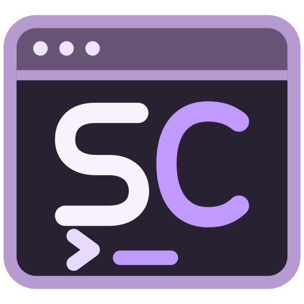
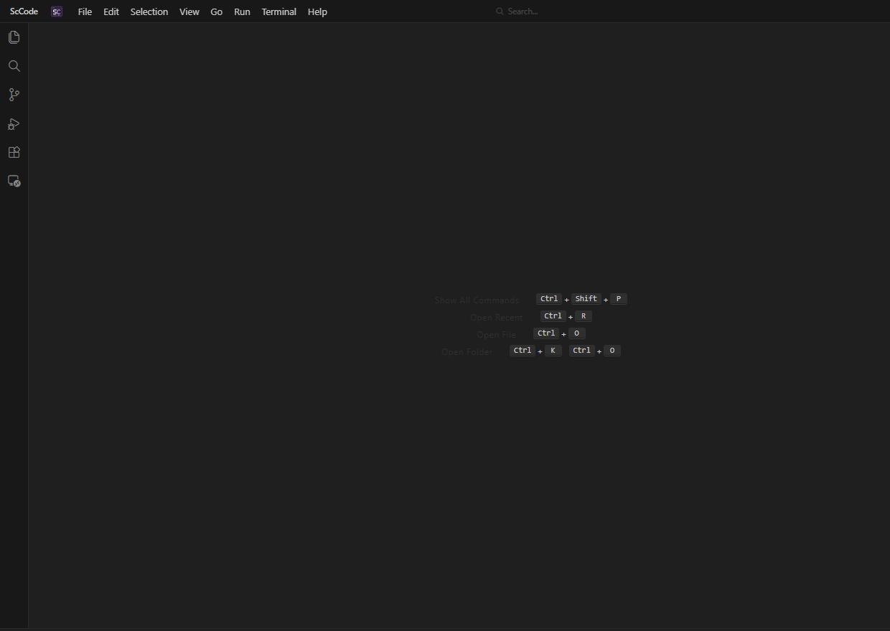

# ScCode

<div align="center">
  
  <h1>ScCode</h1>
  <p>基于 <b>Tauri + Rust</b> 的独立桌面代码编辑器与 AI 开发工作台</p>

[](#系统要求)
[](#技术栈)
[](#从源码构建)
[](#技术栈)
[](../../releases/latest)
[](LICENSE)

  
</div>

ScCode 是一个从 VS Code workbench 迁移、并独立演进的桌面编辑器：前端保留熟悉的
工作台、编辑器、终端与扩展 UI；原生层用 **Rust + Tauri 2** 替代 Electron；内置 Agent
由**受监督的 Go 进程**提供本地模型调用与工具执行；扩展可由 **Node 扩展宿主**运行。

> 当前为 **0.1.1 开发验收版本**，Windows x64 产物可本地打包并上传 GitHub Release。
> 未签名；源码完整迁移不等于全部行为验收完成，第三方扩展矩阵仍在验收中。

## 特性

**编辑器与工作台**
- VS Code 1.110 workbench 基线：命令面板、多标签、分屏、资源管理器、搜索、SCM、任务、调试
- Monaco 编辑器、TextMate 语法高亮、原生 Rust 文本/语法/搜索/主题服务
- 集成终端（xterm）、shell integration、多根工作区与 `.code-workspace`
- 设置、快捷键、主题与 UI 状态持久化；桌面版存储在 profile 内 SQLite

**扩展**
- 安装 VSIX、拖拽安装、扩展市场代理、扩展同步
- Node 扩展宿主：默认 CJS 仿制宿主；可通过实验开关启用 VS Code 真实扩展宿主
- WASM 扩展：Rust + WASI Component Model，`sc-code.toml` 清单
- 扩展 secrets 走 OS keyring；Memento 串行、加锁、原子落盘

**AI 工作台**
- 本地 Go Agent 服务：聊天、工具调用、MCP、记忆、会话、上下文压缩
- Workbench 聊天/内联编辑/补全入口；Agent 面板默认收起
- 本地服务仅监听 loopback，每进程随机 token，Host/Origin 校验
- 模型供应商凭据由 Rust 解析后经进程环境传入 Go 服务，不写配置文件

**数据与配置**
- 独立 profile：Windows 默认 `%APPDATA%\ScCode`，可用 `SC_CODE_HOME` 隔离
- 设置、工作台状态与扩展 secrets 分别持久化到 profile SQLite 与 OS keyring
- 数据库损坏或锁占用会报错并保留文件，不删除数据库假恢复

## 下载安装

前往 [Releases](../../releases/latest) 下载 Windows x64 产物：

| 产物 | 用途 |
|---|---|
| `ScCode_<version>_x64-setup.exe` | NSIS 安装包 |
| `ScCode_<version>_x64-unpack.zip` | 免安装目录包，解压即用（zip 内无版本子目录） |

**免安装包使用方式：** 解压 `ScCode_<version>_x64-unpack.zip` 到任意空目录，直接双击
`ScCode.exe`。zip 根目录就是程序根目录，不含 `ScCode_<version>_x64-unpack/` 外壳目录；
必须复制**整个解压目录**，不能只复制 EXE；目录内含 Node、Agent 侧车、扩展宿主、内置扩展、终端集成与许可证。

> 发布产物必须同时上传 setup exe 与 unpack zip；只上传安装包视为发布未完成。
> 当前未做代码签名，首次运行可能触发 Windows SmartScreen：点「更多信息」→「仍要运行」。

### 系统要求

- **Windows 10 1809+ / Windows 11，x64**
- **Microsoft Edge WebView2 Runtime**（Win10/11 通常已随 Edge 预装）
- 免安装包不执行 WebView2 引导下载；缺失时请先安装 Evergreen 版

免安装不等于 portable 模式：默认用户数据仍在 `%APPDATA%\ScCode`，
可用 `SC_CODE_HOME` 指定其它目录。升级时解压新版本 zip 即可，不会触碰用户 profile。

## 从源码构建

前置：Node.js 22、npm、Rust stable（至少 1.91）、MSVC C++ 构建工具、WebView2；
构建 Go Agent 需要 Go 1.26+ 与支持 CGO 的 C 编译器。工具路径可用
`SC_CODE_GO_BINARY` / `CC` 指定。

日常入口（可从任意目录调用，均支持 `--help` / `--dry-run`）：

| 脚本 | 用途 |
|---|---|
| `setup.bat` | 安装依赖、准备固定 Node/Go/内置扩展并生成元数据 |
| `run.bat [应用参数]` | 前台启动当前 Debug 桌面；缺失或源码变化时自动重建 |
| `dev.bat` | Tauri 热更新开发，带完整 runtime 资源配置 |
| `build.bat [Debug或Release]` | 构建成品包；Debug 生成 unpack 目录 + zip，Release 生成 setup + unpack 目录 + zip |
| `release.bat` | 一键构建 Release setup、未压缩 unpack 目录与 unpack zip，不自动签名/发布 |
| `test.bat` | Node/transport/TS + 选定原生模块和桌面 lib 回归 |
| `verify.bat` | 测试 + 来源清单/runtime/真实本地服务/文档检查 |
| `clean.bat` | 清理生成输出；保留 packages/、工具缓存、node_modules 与用户配置 |

```powershell
Set-Location D:\Git\zgithub\sc-code
.\setup.bat
.\run.bat
.\build.bat Debug
.\release.bat
```

也可以直接调用 npm 脚本：

```powershell
npm run setup
npm run runtime:prepare -- --test-go
npm run desktop:dev
npm run desktop:build -- --debug --target x86_64-pc-windows-msvc --bundles nsis
npm run desktop:release
```

`npm run dev` 只是 web 工作台开发服务器，不包含原生服务，不代表完整编辑器运行。

### 打包产物

- `packages/dev/unpack/`
  — Debug 未压缩运行目录，含 PDB 等调试信息，用于开发测试。
- `packages/dev/ScCode_<version>_x64-unpack-debug.zip`
  — Debug 压缩包，zip 根目录即程序根目录，无版本子目录。
- `packages/release/unpack/`
  — Release 未压缩运行目录，不含 Cargo 缓存、PDB 或用户配置。
- `packages/release/ScCode_<version>_x64-setup.exe`
  — Release NSIS 安装包。
- `packages/release/ScCode_<version>_x64-unpack.zip`
  — Release 压缩包，zip 根目录即程序根目录，无版本子目录。

打包顺序：先校验构建资源并导出 `packages/<mode>/unpack/`，再以该目录为源生成 zip；
最后导出本次新生成的安装包。构建中间产物统一收拢至 `.runtime/`
（`target/`、`dist/`、`desktop/` 等），不纳入版本管理。

## 项目结构

```
src/                      # TypeScript 前端（VS Code workbench 定制）
  sc-code/                #   自有功能：VSIX 安装、accessibility、profile 扩展同步
  vs/                     #   workbench / 平台 / 编辑器
src-tauri/                # Rust 原生层与 Tauri 装配
  src/commands/           #   设置、扩展、存储、secrets、Agent、调试等命令
  extension-host/         #   Node 扩展宿主（生产 CJS）
crates/                   # Rust 工作区：sc-code-text / sc-code-syntax / sc-code-lsp ...
agent/                    # Go Agent 服务（server）、独立 Rust agent-core 与 CLI
src-wasm/                 # WASM 模块（hash / scroll / tfidf）
extensions-rust/          # Rust → WASM 内置扩展
packages/                 # 本地打包产物（不纳入版本管理）
docs/                     # 来源清单与截图资源
```

## 技术栈

- **前端**：TypeScript + VS Code workbench 1.110 + Monaco + xterm
- **原生层**：Rust + Tauri 2（Windows WebView2）
- **Rust 服务层**：`crates/sc-code-*`（文本、语法、LSP、Git、终端、扩展、设置、存储等）
- **Agent**：Go 1.26 本地服务 + Rust 工具桥 + Workbench 聊天/内联/编排
- **扩展**：Node 扩展宿主 + Rust/WASM Component Model
- **存储**：SQLite（profile/工作台状态）、OS keyring（扩展 secrets）

设计取舍：

- **用 Tauri 替代 Electron**：复用系统 WebView2，减小安装体积与常驻内存。
- **保留 VS Code workbench**：命令/设置/扩展 API 兼容边界不重写，逐步替换原生能力。
- **Agent 独立进程**：Go 服务只监听 loopback，崩溃可监督重启，不阻塞编辑器主进程。
- **数据自包含**：所有用户数据位于独立 profile，不读写其它应用的数据目录。

## 数据与配置隔离

Windows 默认 profile 为 `%APPDATA%\ScCode`。设置、工作台状态、扩展数据与 Agent
状态都保存在该 profile 内，不读写其它应用的数据目录。

隔离测试 / 自定义 profile：

```powershell
$env:SC_CODE_HOME = 'D:\Temp\sc-code-test-profile'
npm run desktop:dev
```

WebView、原生数据、扩展宿主及自管 Agent 使用同一 profile 根。关闭应用后清除测试
环境变量，避免误把测试 profile 当默认应用。

## 验证

```powershell
npm test
npm run test:transport
npm run typecheck
cargo test -p sc-code-runtime -p sc-code-auth -p sc-code-workspace -p sc-code-settings -p sc-code-extensions
cargo test -p sc-code --lib
npm run runtime:prepare -- --test-go
npm run test:server
npm run verify:import
# Git Bash
bash check-docs.sh
```

`npm test` 包含实际 fork 生产 Node 宿主的合成扩展测试；不读取用户 profile 或真实
keyring。`test:server` 启动真实 Go exe，只用临时 profile 和随机凭据，验证
REST/WS/Origin/Host；不注入用户 API key，不调用模型。

性能基线：`npm run perf:baseline`（冷启动到窗口时间 + 进程树工作集，输出
`.runtime/logs/perf-*.json`）。

## 实验开关：真实 Node 扩展宿主

默认使用 `host.cjs` 仿制宿主。启用 VS Code 真实扩展宿主：

```powershell
npm run ext-host:build          # 构建 .runtime/ext-host/extensionHost.cjs
$env:SC_CODE_REAL_EXT_HOST='1'  # 构建期注入；也可用 ?realExtHost=1
npm run desktop:dev
```

真实宿主通过 loopback WebSocket + `PersistentProtocol` 通信，扩展在独立 Node
进程中运行；`extension-host/extensionHost.cjs` 会随 `runtime:prepare`/打包进入运行
资源。当前为实验路径，第三方扩展矩阵仍在验收。

## 安全边界

- 保留 VS Code API 1.110.0 基线；命令/设置 ID、`sc-code://` 协议与内部 Rust
  crate/进程命名统一使用 ScCode 标识。
- 扩展发现不再静默封禁固定 ID。可通过 `SC_CODE_DISABLE_EXTENSION_IDS`
  （逗号分隔、大小写不敏感）禁用。
- 自管 Go/Node 使用每进程 token，只监听 loopback。独立手动启动 Go server
  必须配置 `SC_CODE_LOCAL_TOKEN`。
- 默认关闭旧自动更新和遥测；`SC_CODE_TELEMETRY=1` 显式启用遥测。
- 当前 checkpoint 是内存恢复与单文件冲突保护，不是持久化多文件事务，
  不保证回滚任意 shell/Git/worktree 副作用。
- CSP/workspace trust 尚未完善；不要把当前版本当作完全沙箱，不要运行不可信
  扩展/项目。秘密索引 `secure_delete` 不能保证旧 WAL/空闲页已彻底擦除。
- 未签名；完整 GUI/扩展矩阵与跨平台打包仍待验收。

## 文档

| 文档 | 内容 |
|---|---|
| [`AGENTS.md`](AGENTS.md) | AI 代理工作规则（改代码前先读） |
| [`ARCHITECTURE.md`](ARCHITECTURE.md) | 代码地图：文件职责、任务→位置、重点链路、易踩坑 |
| [`ROADMAP.md`](ROADMAP.md) | 要做什么、做到哪了 |
| [`CHANGELOG.md`](CHANGELOG.md) | 每个版本的变化 |
| [`HANDOFF.md`](HANDOFF.md) | 当前会话接力与待办 |
| [`docs/import-manifest.json`](docs/import-manifest.json) | 来源文件清单与哈希校验 |

## 许可

本项目保留 `LICENSE` 与第三方版权/许可声明。独立项目不意味着移除来源归属。
